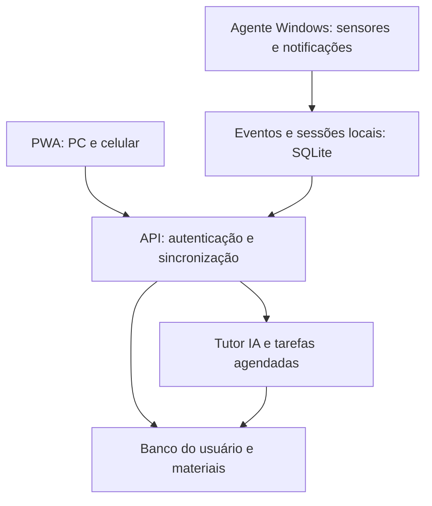

# Plano de evolução do WorkWatch para tutor pessoal de estudos

**Estado:** proposta para revisão · **Base analisada:** `main` em `f64fdebbbd38c1cd78c8b3baf465b1f04e0e6ada` (16/05/2026) · **Nome de trabalho:** Ritmo (nome final pendente)

## 1. Propósito e limites do produto

Evoluir o WorkWatch de coletor local de eventos do Windows para assistente pessoal de estudos acessível no PC e no celular. O sistema deve ajudar a planejar, estudar, praticar, revisar e ajustar o ritmo de aprendizado. Seu valor será demonstrado por retenção, autonomia, qualidade das respostas e constância sustentável, além dos minutos efetivos.

**Primeiro público:** o próprio autor; projeto de portfólio com arquitetura que permita, no futuro, outras contas. A experiência inicial é pessoal, sem recursos de gestão corporativa. Uma oferta para terceiros exigirá políticas, permissões e revisão de dados próprias.

**Princípios:**

- O usuário controla sensores, notificações, restrições de foco e memória de padrões. Todas as restrições têm suspensão imediata.
- Observação de janela, ausência e ociosidade é evidência contextual, não prova de aprendizado, produtividade, fadiga ou condição clínica.
- Dados objetivos e cálculos ficam em serviços determinísticos. A IA explica, avalia com rubricas, propõe planos e recomenda ajustes, sempre com fonte e incerteza quando apropriado.
- A IA não altera diretamente metas, notas, bloqueios ou memórias sem uma operação validada e registrada.
- A experiência de estudo funciona sem webcam; câmera é um sensor opcional, ligado apenas durante sessões escolhidas.
- Dados brutos ficam locais por padrão. Só agregados e conteúdos necessários são sincronizados, conforme as escolhas do usuário. Chaves de API nunca vão ao cliente ou repositório.

## 2. Inventário do repositório e diagnóstico

| Arquivo atual | Situação observada | Tratamento planejado |
|---|---|---|
| `main.py` | Cria threads para janela, presença, ociosidade e multitarefa; carrega JSON por caminho relativo. | Manter a ideia de processos de coleta; introduzir inicialização validada, supervisor, eventos tipados e encerramento controlado. |
| `monitor/window_tracker.py` | Lê título e processo da janela ativa, grava linha CSV e chama classificador. | Reaproveitar o sensor; separar captura, classificação e persistência; tratar janelas fechadas/processos inacessíveis e minimizar coleta de títulos sensíveis. |
| `monitor/idle_tracker.py` | Usa `GetLastInputInfo`; limiar de 60 s fixo. | Tornar limiar configurável por contexto, emitir intervalos e cruzar apenas com sessão ativa. |
| `monitor/presence_detector.py` | Abre a webcam a cada leitura, detecta rosto e registra mudanças. Ignora o argumento `interval` e espera 10 s fixos. | Corrigir ciclo e estados `presente/ausente/indisponível`; autorização explícita e nenhum armazenamento de imagem por padrão. |
| `monitor/multitask_analyzer.py` | Classifica as últimas amostras, mesmo quando o mesmo programa é repetido; pode registrar eventos continuamente. | Consumir mudanças reais de janela com timestamps; avaliar uma janela temporal, taxa de alternância e deduplicação. Nunca rotular automaticamente uma pessoa como desatenta. |
| `monitor/app_classifier.py` + `config/classificacao_apps.json` | Classifica executáveis em categorias estáticas. `chrome.exe` é neutro independentemente da atividade. | Categorias por contexto da sessão e regras editáveis; `navegador` sozinho não determina estudo/distração. |
| `monitor/usage.aggregator.py` | Classe de soma por programa presente, mas sem integração ao fluxo. | Renomear para `usage_aggregator.py`, integrar por eventos e excluir pausas/ociosos dos cálculos de estudo. |
| `storage/database.py`, `dashboard/app.py`, `analyzer/content_classifier.py`, `utils/config.py`, `utils/logger.py` | Arquivos vazios. | Implementar conforme a fase; não anunciá-los como funcionalidades prontas. |
| `README.md` e `projeto.txt` | Documentam bem a intenção anterior, mas misturam itens atuais, futuros e uma proposta corporativa. | Preservar o histórico do WorkWatch e atualizar objetivo, execução, arquitetura, estado real, privacidade e roadmap. |

### Bloqueadores antes de ampliar funcionalidades

1. **Importação circular:** `window_tracker.py` importa `app_classifier.py`, que importa `salvar_linha` de `window_tracker.py` antes de sua definição. Isso pode impedir `python main.py` de iniciar. Extrair a escrita para um módulo independente e remover o ciclo.
2. **CSV inconsistente:** os eventos de janela escrevem cinco campos, outros quatro; títulos com vírgulas/quebras de linha não são escapados. Várias threads escrevem no mesmo arquivo sem um gravador único. Não usar esse CSV como fonte confiável do tutor.
3. **Configuração e execução:** caminhos relativos, ausência de `requirements.txt`/arquivo de dependências e diretórios presumidos dificultam reproduzir a execução. Configuração sem validação pode quebrar na inicialização.
4. **Métricas de multitarefa:** amostras repetidas não representam trocas de janela e geram falsos alertas. Um evento precisa de início, fim e contexto da sessão.
5. **Observabilidade:** exceções nos monitores são apenas impressas; uma thread pode parar enquanto o processo principal aparenta continuar funcionando.

Este é um diagnóstico estático do repositório. A primeira tarefa de implementação deve reproduzir a execução em Windows e registrar os resultados; nenhum teste de execução foi feito neste planejamento.

## 3. Arquitetura alvo, sem reescrever tudo de uma vez



- **Agente Windows (Python):** evolução do código atual; capta apenas sensores habilitados, produz eventos padronizados, guarda fila local e executa restrições opcionais de foco. Deve continuar útil quando a rede cair.
- **Interface PWA:** plano, timer, aulas, suporte a questões, notas, simulados, revisões e painel. No celular, registra atividades feitas fora do Windows; não presume acesso a todos os apps do sistema.
- **API Python (proposta: FastAPI):** regras de negócio, autenticação, sincronização, upload, agenda de notificações e chamadas à IA. API key apenas no servidor. Escolha do framework deve ser validada na prova de conceito.
- **Persistência:** SQLite no agente e primeira versão local; banco relacional no servidor quando houver sincronização entre dispositivos. Definir migrações desde a primeira versão. Notion pode ser origem para importação e exportação, sem ser a fonte transacional do sistema.
- **IA:** adaptadores para provedor e modelo, com limites de custo, prompts versionados, trilha de recomendações e avaliações. Processamento de mídia em tarefas assíncronas.
- **Integrações futuras:** conectores de calendário, Notion, fontes de mercado, notificações e outros modelos por interfaces separadas do domínio. Nenhuma é requisito para registrar uma sessão.

Estrutura sugerida, a introduzir gradualmente:

```text
agent/                 # sensores Windows, fila, notificações, foco opcional
api/                   # endpoints, autenticação, sincronização, jobs
core/                  # entidades, cálculo de tempo, revisão, recomendações
storage/               # migrações, repositórios SQLite/servidor
web/                   # PWA responsiva
ai/                    # tutor, rubricas, materiais, avaliação e provedores
tests/                 # testes de regras e fluxos críticos
docs/                  # arquitetura, privacidade, contratos e ADRs
```

## 4. Modelo de dados e CRUD

**Convenções:** identificador estável UUID; `user_id` em todo dado pessoal; timestamps em UTC, apresentados no fuso do usuário; `created_at`, `updated_at`, `deleted_at` onde couber; alterações e sincronização com `version`. Eventos e tentativas são append-only: correções criam um registro de ajuste, preservando o original. Exclusão lógica mantém referência para sincronização; exclusão definitiva é oferecida na gestão dos dados.

| Entidade ou agregado | Criar | Ler | Atualizar | Excluir/arquivar | Regras essenciais |
|---|---|---|---|---|---|
| Perfil, metas, preferências e permissões | Cadastro inicial | Painel/configurações | Metas, horário, estilo, sensores, intensidade de alertas | Conta/dados: fluxo explícito | `consentimentos` por sensor/finalidade; histórico mínimo da alteração. |
| Matéria e tópico | Usuário/importação | Lista, progresso, dependências | Nome, ordem, prioridade, status | Arquivar; excluir se vazio ou confirmar impacto | Não perder sessões vinculadas ao arquivar. |
| Plano e bloco agendado | Usuário/IA com confirmação | Calendário e agenda | Reagendar, duração, modo de estudo | Cancelar | Guardar planejado separado do realizado. |
| Sessão e intervalos | Iniciar, pausar, retomar, concluir | Linha do tempo e totais | Ajuste manual com justificativa | Arquivar ou apagar conforme política de dados | Estados `planejada/em_foco/em_pausa/interrompida/concluída`; sem sobreposição indevida. |
| Evento do agente | Captura automática autorizada | Diagnóstico e agregação | Não editar; anexar correção | Expirar/apagar dados brutos | `event_id`, device, sensor, timestamp e contexto; deduplicação na sincronização. |
| Material e versão | Upload/importação | Biblioteca, origem, processamento | Título, tags, versão | Excluir original e derivados após confirmação | Estado `pendente/processando/pronto/falhou`; PDF/DOCX/vídeo com metadados e referência à origem. |
| Anotação | Texto, voz transcrita ou trecho | Pesquisa por matéria/material | Editar e vincular dúvidas | Lixeira/recuperação | Usável no celular e offline; sincronização de conflitos explícita. |
| Questão e rubrica | Usuário/IA | Banco e simulados | Revisar versão e gabarito | Arquivar | Questão gerada indica origem e pode ser marcada incorreta. |
| Tentativa, pistas e correção | Resposta ou pedido de pista | Histórico e explicação | Não sobrescrever; registrar revisão da correção | Apagar com dados do usuário | Rastrear acerto, autonomia, pistas, explicação e confiança separadamente. |
| Agenda de revisão | Gerada após tentativa/aula | Pendentes e histórico | Reagendar ao revisar | Dispensar/arquivar | Início 1/3/7 dias; adaptar pelos resultados, sem penalizar ausência justificada. |
| Padrão pessoal e feedback | Regra/IA propõe observação | Memória inspecionável | Usuário corrige, invalida ou confirma | Apagar observação ou toda a memória | Guardar evidência, confiança, contexto, validade e feedback; sem rótulo clínico. |
| Regra e entrega de notificação | Configuração/job | Histórico | Silenciar, mudar canal e horário | Remover regra/limpar histórico | Evitar duplicação, limites por dia, adiamento e horários silenciosos. |
| Recompensa/conquista | Regra do sistema | Painel | Correção por ajuste de eventos | Revogar se origem for invalidada | Valorizar aprendizagem, retenção e pausas adequadas, não só horas. |
| Execução da IA | Chamada pelo tutor/job | Auditoria pessoal e métricas | Feedback do usuário (novo registro) | Política de retenção | Modelo, versão do prompt, custo estimado, latência, fontes e resultado; sem chave em logs. |

**CRUD não é uma tela para cada tabela.** A interface agrupa ações por fluxo: `Meu plano`, `Estudar`, `Materiais`, `Anotações`, `Praticar`, `Revisões`, `Evolução` e `Configurações`. Camadas de API/repositório mantêm contratos estáveis (`create/get/list/update/archive/delete`). Em endpoints de eventos e tentativas, usar POST e leitura; alterações acontecem por comandos de correção, não por PUT destrutivo.

### Exemplo de cálculo de sessão

Uma sessão das 19h00 às 20h00 pode conter foco 19h00–19h25, pausa 19h25–19h35, foco 19h35–19h55 e encerramento às 20h00. O total de estudo registrado é 45 min, com 10 min de pausa e 5 min não classificados; sem confirmação ou evidência suficiente, os últimos 5 min não viram estudo automaticamente. O usuário pode corrigir o registro, com motivo. Janelas abertas, mouse parado, vídeo tocando e resposta demorada são sinais para perguntar, não multiplicadores arbitrários do tempo.

## 5. Regras de produto

### Estudo e adaptação

- Perfil inicial: meta de 8 h por semana, acompanhamento dos 7 dias e revisões em 1/3/7 dias como preferências editáveis. Resultado, retenção e autonomia aparecem separados de minutos.
- Modos: livre, blocos curtos (ex.: 25/5), 45/15 e personalizado. A IA pode sugerir mudança com base em feedback e histórico; o usuário aceita antes de mudar a configuração.
- Estado de cansaço é uma hipótese contextual. Queda de acertos, sessões longas e auto relato podem levar a uma pergunta ou pausa sugerida; não a uma afirmação de fadiga médica.
- Padrões internos incluem demora para iniciar, interrupções, mudanças reais de janela, sessões abandonadas e quantidade de pistas. Exibir apenas recomendações úteis na tela principal; permitir ver, corrigir e apagar a memória nas configurações.
- Não inferir TDAH, hiperfoco ou outra condição clínica a partir de telemetria. Uma futura área de auto-observação e encaminhamento deve ser um recurso separado, opt-in.

### Modo Orientador e simulados

1. Importar/criar uma questão e associar matéria, tópico e origem.
2. Pedir a tentativa inicial do usuário. A IA identifica pré-requisitos e oferece uma pista por vez: conceito, pergunta de raciocínio, exemplo análogo e checagem final.
3. Durante o modo de avaliação, não revelar diretamente a alternativa ou resposta. Permitir que o usuário declare as regras da prova e restringir recursos conforme elas.
4. Após a resposta e, quando existir, gabarito/correção confiável, registrar erro, tipo de erro, pistas usadas, autonomia e revisão agendada. Se não houver gabarito, marcar avaliação da IA como provisória.
5. Simulados têm banco versionado, dificuldade progressiva e análise por tópico. A resposta nunca é avaliada somente por comparação textual literal.

### Materiais, voz e mercado

- Vídeo enviado pelo usuário: metadados, extração do áudio, transcrição com timestamps, tópicos, aula escrita, resumo, questões e trechos verificáveis. Separar material original de resumo; não apagar contexto necessário sob a etiqueta de “papo furado”.
- PDF/DOCX: extração, páginas/trechos de origem, índice pesquisável, anotações e perguntas. Conteúdo sem extração confiável deve sinalizar limitação.
- Voz em etapas: (1) notas por ditado; (2) áudio das explicações; (3) conversa falada. Começar por gravação e transcrição assíncrona, deixando tempo real para depois.
- Mercado: tarefa periódica busca fontes datadas, separa fato de tendência, propõe tópicos ligados ao objetivo profissional (dados, Python, automação, Power Platform) e exige revisão do usuário antes de alterar o plano.

### Recompensas e foco opcional

- Conquistas por revisão concluída com retenção, resposta independente, retomada após dificuldade e constância equilibrada; não incentivar estudo sem pausas.
- Restrições de foco só no agente Windows, com lista escolhida pelo usuário, horários e dispositivos definidos. Suspensão imediata, exceções e limite de duração obrigatórios. Nunca bloquear o próprio controle do app, recursos essenciais ou impedir uma pausa.
- Notificações de queda ou excesso usam janelas de observação e texto ajustável. Limitar frequência e registrar se a sugestão ajudou.

## 6. Sequência de implementação e critérios de conclusão

| Etapa | Entrega principal | Critério verificável |
|---|---|---|
| **0 — estabilizar** | Reproduzir execução Windows; resolver import circular; configurar dependências, caminhos, validação, logs estruturados e teste mínimo de cada sensor. | `python main.py` inicia e para; eventos simultâneos não corrompem dados; falha de sensor fica visível. |
| **1 — domínio local** | SQLite/migrações, perfis, matérias/tópicos, sessões/intervalos, anotações, cálculo de tempo, exportação. | Criar, pausar, retomar, corrigir e consultar uma sessão; fechar/reabrir sem perder dados; importar CSV antigo com relatório de linhas rejeitadas. |
| **2 — interface e sincronização** | API com autenticação, PWA responsiva, fila local, reconciliação e notificações básicas. | Iniciar no PC, anotar no celular e ver o mesmo histórico; evitar duplicação após reconexão. |
| **3 — tutor e prática** | Materiais textuais, modo Orientador, rubricas, banco de questões, tentativas e revisões. | Resolver uma questão com pistas graduais; registrar correção e disparar revisão em 1/3/7 dias. |
| **4 — personalização** | Memória de padrões, sugestões de ritmo, alertas de excesso/queda, feedback e recompensas. | Toda sugestão mostra evidência; usuário corrige/apaga padrão; regras respeitam horários e pausas. |
| **5 — multimodal** | PDFs/DOCX, vídeos, voz e anotações por áudio. | Um material vira aula e questões com localização da origem; falha de transcrição permite reprocessar sem duplicar. |
| **6 — extensões** | Restrições Windows, fontes do mercado, integrações e avaliação contínua da IA. | Suspensão de bloqueio funciona sempre; fontes são datadas; comparar versão nova do tutor com casos de referência. |

Cada etapa deve fechar com demonstração, captura de tela ou vídeo para portfólio, documentação da decisão e uma pequena bateria de casos reais. Evitar criar uma interface extensa antes de validar as regras de sessão e as primeiras avaliações.

## 7. Primeira lista de trabalho para implementação

1. Criar branch de implementação separada da documentação e registrar ambiente Windows usado para reproduzir o problema de importação.
2. Mover `salvar_linha` para `utils/logger.py` ou novo `storage/event_writer.py`; atualizar imports de `window_tracker`, `idle_tracker`, `presence_detector`, `multitask_analyzer` e `app_classifier`.
3. Trocar montagem manual do CSV por escrita serializada com schema único, ou inserir eventos diretamente no SQLite com fila única. Preservar importador para logs antigos.
4. Criar arquivo de dependências com versões testadas, configuração de exemplo, diretório de dados do usuário e comando de diagnóstico. Não versionar telemetria nem material privado.
5. Corrigir `presence_detector` para respeitar intervalo e diferenciar falha de câmera de ausência; corrigir amostragem de multitarefa e limiar de ociosidade.
6. Criar `Session`, `SessionInterval`, `Subject`, `Topic`, `Note` e respectivas migrações e operações; só depois iniciar a interface.
7. Testar transições de sessão, cálculos com meia-noite/fuso e simultaneidade de escrita; fazer teste manual de câmera, fechamento e retomada no Windows.

## 8. Riscos, dependências e decisões pendentes

| Risco ou decisão | Encaminhamento |
|---|---|
| **Projeto público e dados pessoais** | Manter banco, imagens, áudio, notas, tokens e logs fora do Git; revisar `.gitignore` e exemplos antes de publicar. |
| **Privacidade de títulos de janela** | Filtrar/mascarar títulos de apps sensíveis; sincronizar preferencialmente agregados; retenção curta para eventos brutos. |
| **Câmera e falsos positivos** | Opt-in por sessão; estado `indisponível`; nunca associar automaticamente ausência a abandono. |
| **Bateria e desempenho** | Reduzir frequência de sensores, coletar eventos de mudança e processar vídeo de forma econômica. |
| **Offline e conflitos** | IDs gerados localmente, fila de sincronização, idempotência, versionamento e tela de conflito para notas editadas em dois dispositivos. |
| **IA e custo** | Limites de uso, cache de materiais, filas, escolha de modelo por tarefa e avaliação de qualidade por conjunto de casos de referência. |
| **Aulas e direitos** | Receber material que o usuário tem permissão de processar; evitar redistribuição e controlar armazenamento. |
| **Bloqueios** | Prototipar em Windows apenas depois de uso real do timer; interrupção sempre disponível. |
| **Identidade do projeto** | Manter histórico WorkWatch; escolher nome final antes de renomear repositório, pacote, README e imagens. |
| **Escopo comercial** | Adiar multiusuário, equipe e modo corporativo até o assistente pessoal estar validado. |

## 9. Marcos de portfólio

- **Marco A:** WorkWatch reparado, sensores reproduzíveis e dados íntegros.
- **Marco B:** sessão e anotações sincronizadas entre PC e celular.
- **Marco C:** tutor com pistas e revisão que demonstra melhoria em casos reais.
- **Marco D:** adaptação explicável do ritmo, com proteção contra excesso.
- **Marco E:** mídia, voz e extensões de foco.

Cada marco deve mostrar o problema, uma decisão técnica, uma demonstração e uma limitação conhecida. A evolução do projeto original é parte valiosa da história do portfólio.
